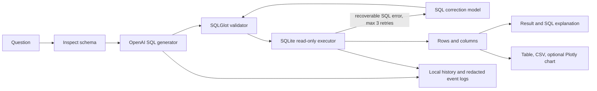

# Autonomous Text-to-SQL Agent

A Streamlit analytics workspace that translates plain-language questions into read-only SQLite queries, validates them, executes them with resource limits, and presents the returned rows with concise AI explanations and optional charts.

## Requirements and source of truth

The official Task 10 brief was found on page 7 of `Natural Language Processing Tasks.pdf` inside the Elevvo task archive in the workspace. Its core requirements and exact bonus wording are transcribed in [OFFICIAL_REQUIREMENTS.md](OFFICIAL_REQUIREMENTS.md). The official bonus includes an agent-selected Chart Tool and read-only database permissions. Other features requested in the supplied master prompt are labelled additional enhancements.

## Features

- Schema-grounded SQL generation through the official OpenAI Python SDK; asks a clarifying question when needed.
- SQLGlot parsing plus a SQLite read-only URI, authorizer, query-only mode, query deadline, dangerous-function checks, and capped result rows.
- Up to **three correction attempts after the initial query**, limited to recoverable SQLite syntax/schema errors. Every replacement is validated independently.
- Actual-result summaries, plain-English SQL explanation, row and column details, execution time, retry count, and a short activity trace.
- Interactive result table, CSV and SQL downloads, and user-selected Plotly bar, line, or pie charts when numeric results support them.
- Local query history with status, timestamps, reuse, favourites, and clear-history control. The OpenAI key is not written to history.
- Schema explorer with columns, types, primary keys, foreign keys, relationship display, and search.
- Official **Chart Tool** bonus: the agent may suggest a chart, which is verified against the actual output structure; users can change the chart settings.
- Official **Read-Only** bonus: independent parser, read-only connection mode, query-only mode, and authorizer checks.
- Additional enhancements from the supplied master prompt: SQLite uploads, schema explorer, local history and favourites, exports, benchmark harness, redacted logging, and schema-only mode.
- Schema exploration works without an API key; the UI clearly disables live AI behavior in that mode.

## Architecture



The workflow is a bounded LangGraph state graph with explicit generation, validation/execution/correction, and summarization stages. SQL is the only model-generated artifact that can reach the database, and it must pass deterministic validation. Read-only SQL reduces risk; it does not replace normal application security.

## Technology

- Python 3.11+
- Streamlit 1.66.1, OpenAI 3.42.1, LangGraph 1.2.19, SQLGlot 30.27.0
- Pandas 3.1.0, Plotly 7.1.0, python-dotenv 1.2.4
- SQLite (Python standard library), pytest 9.2.0

Pinned versions were selected for Python 3.13 compatibility based on PyPI package metadata. The workspace reports Python 3.13 installed, but its launcher was denied execution during project setup, so package installation and local runtime compatibility still need verification on a permitted Python installation.

## Database setup

The setup script downloads the Chinook SQLite file from the [lerocha/chinook-database release](https://github.com/lerocha/chinook-database/releases), checks SQLite integrity and required tables, then saves it under `data/Chinook.sqlite`. It does not create synthetic business data. If network access fails, it removes the partial file and prints a clear retry instruction.

```powershell
py -3.11 database/setup_database.py
```

The database is omitted from Git. The app opens the sample and uploaded databases in read-only mode. Users may upload a compatible SQLite file from the sidebar (up to 100 MB); files are checked for the SQLite signature, integrity, and tables before use.

## Windows installation

```powershell
py -3.11 -m venv .venv
.venv\Scripts\activate
python -m pip install --upgrade pip
pip install -r requirements.txt
Copy-Item .env.example .env
streamlit run app.py
```

Open `.env` and set `OPENAI_API_KEY` to your own API key. Keep `.env` private; it is ignored by Git. `OPENAI_MODEL` defaults to `gpt-4o-mini`. Without an API key, database schema exploration remains available, while live query generation and AI explanations are unavailable.

Optional controls include `DATABASE_PATH`, `MAX_RESULT_ROWS`, `QUERY_TIMEOUT_SECONDS`, and `MAX_CORRECTION_ATTEMPTS` (bounded to 0–3).

## Example questions

- Which artist has the most albums?
- What are the top 10 best-selling tracks?
- Which country generates the highest revenue?
- What is the total revenue by year?
- Which customers have spent more than $50?
- Which genre has the most tracks?
- Show monthly revenue.
- Which employees support the most customers?

## Testing

Tests use temporary SQLite databases and do not modify the Chinook file:

```powershell
pytest -q
```

Coverage includes read-only and CTE validation, destructive and multi-statement rejection, database read-only access, schema keys and relationships, empty and capped results, timeout interruption, invalid identifiers, retry validation, no-key behavior, and CSV export helpers. Live OpenAI calls are not required by the unit tests. Tests have not been run in the current environment because launching the installed Python 3.13 executable was denied.

## Benchmark

`evaluation/benchmark_questions.json` contains 15 varied prompts. Run against a configured API and database with:

```powershell
python evaluation/run_benchmark.py
```

The script records SQL generation, validation, execution, correction attempts, duration, and expected-column presence. Column matching is only a structural proxy; it does not establish semantic answer correctness. **No benchmark results have been collected yet.**

## Screenshots

Add screenshots after starting the application and verifying it locally. No screenshot is included yet.

## Limitations

- Live generation, SQL explanation, and result summarization require a valid OpenAI API key and network access.
- No database file is bundled. Chinook setup requires network access to the upstream GitHub release.
- The benchmark cannot prove semantic correctness from expected columns alone; review the actual SQL and results.
- Uploaded database contents can still contain sensitive information. Use databases you are authorized to analyze and apply normal access controls.
- SQLite read-only mode and SQL validation are defense in depth, not a complete security boundary for arbitrary hostile database files.

## Future improvements

- Add manual approval and curated semantic models for business-critical queries.
- Add richer evaluation with reviewed gold queries and database snapshots.
- Add per-user history storage and configurable retention for deployed environments.
- Add optional query plans and schema relevance ranking for larger databases.
